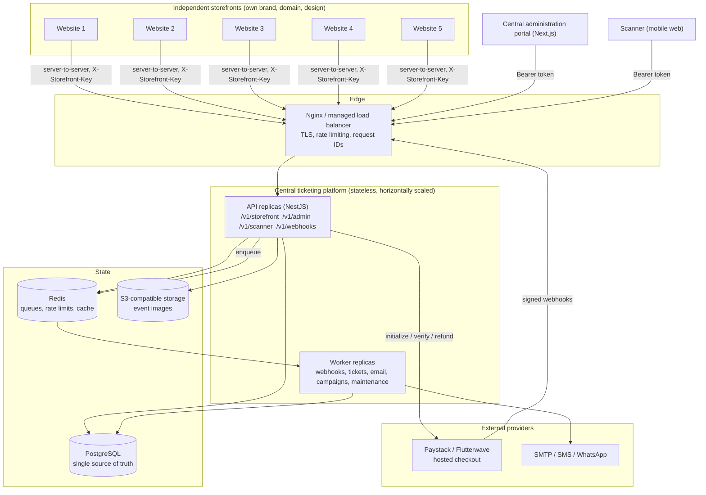
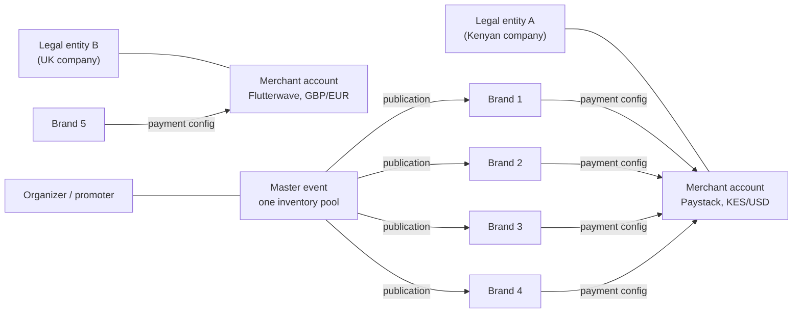
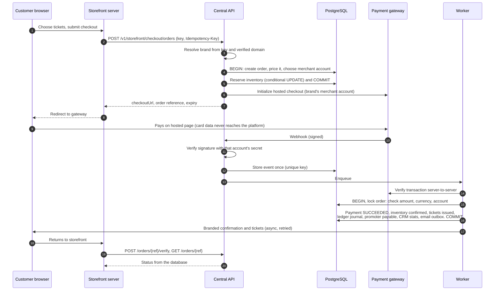
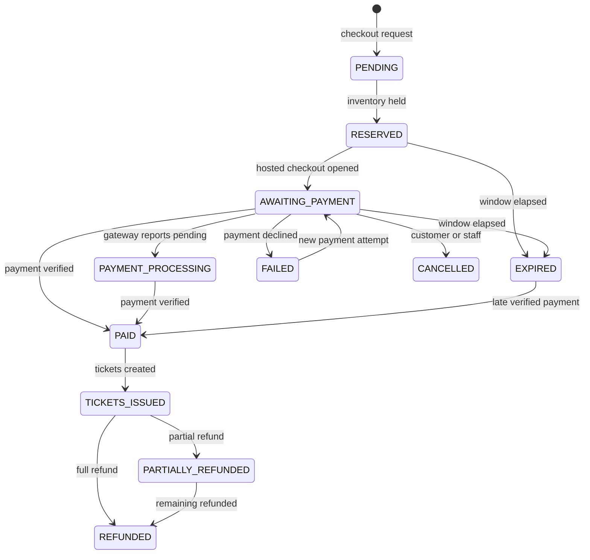
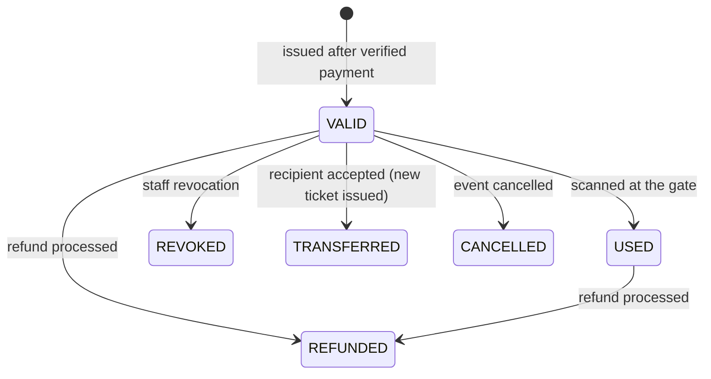

# Central Ticketing Platform: Architecture

This document covers the system architecture, the multi-brand tenant model, payment processing and the financial ledger, the order and ticket lifecycles, the API structure and the implementation roadmap. The database is documented in [DATABASE.md](DATABASE.md); deployment, monitoring and recovery in [OPERATIONS.md](OPERATIONS.md); security and privacy in [SECURITY-PRIVACY.md](SECURITY-PRIVACY.md).

## 1. System architecture



**One platform, many storefronts.** Every storefront is a separate website that calls the same API. There is one database, one inventory ledger, one order book and one ticket validation service. A new brand is added by configuration (a `brands` row, a verified domain, a storefront key, a payment configuration); no code changes and nothing brand-specific exists in the ticketing engine.

**Components**

| Component | Technology | Role |
|---|---|---|
| API | Node.js, NestJS, TypeScript, Prisma | REST API with OpenAPI docs at `/docs`. Stateless: any number of replicas. |
| Workers | Same codebase (`dist/worker.js`), BullMQ | Webhook processing, notification delivery, campaign dispatch, scheduled maintenance. |
| Database | PostgreSQL 16 | Authoritative for inventory, orders, payments, tickets, ledger. Constraints and triggers enforce the critical invariants. |
| Redis | Redis 7 | Job queues, distributed rate limits, short-lived cache of catalogue listings. Never holds inventory or payment truth. |
| Object storage | S3-compatible (or local disk in development) | Event images. Ticket PDFs are rendered on demand and not stored. |
| Admin portal | Next.js, Tailwind | Central administration for all roles, plus the mobile scanner. |
| Demo storefront | Next.js | Reference integration serving the five demo brands by hostname. |

**Module map** (`apps/api/src/modules`)

| Module | Responsibility |
|---|---|
| `access` | Staff sign-in, MFA, sessions, staff and role management |
| `brands` | Brand configuration, domains, storefront keys, policies, legal entities, merchant accounts |
| `catalog` | Master events, venues, performers, per-brand publications, storefront event API |
| `inventory` | The single inventory authority: reserve, confirm, release, reconcile |
| `orders` | Order state machine, checkout API, admin order management |
| `payments` | Gateway adapters, verification, webhooks, pricing and commissions, ledger, refunds, settlements, reconciliation |
| `tickets` | Issuance, QR tokens, PDF rendering, scanning (online and offline sync), transfers |
| `customers` | Central identity, brand relationships, consent, CRM, segments, privacy workflows |
| `marketing` | Campaigns, promo codes, tracking and unsubscribe |
| `notifications` | Templates, transactional outbox, delivery with retries |
| `support` | Support tickets and conversations |
| `reports` | Dashboards and reports |
| `ops` | Health, metrics, alerts, audit log, settings, scheduled maintenance |

**Why this shape scales.** The API holds no state between requests; sessions and rate limits live in PostgreSQL and Redis, so replicas can be added behind the load balancer. Slow or failure-prone work (email, campaign fan-out, webhook processing) is queued. The one deliberately serialised operation is the update of a ticket category's inventory row, which is kept to a few statements (see section 5).

## 2. The multi-brand tenant model



Four distinct parties are modelled separately and recorded on every order:

| Party | Table | Meaning |
|---|---|---|
| Brand | `brands` | What the customer sees: name, logo, domain, colours, sender, support contacts, policies |
| Legal seller | `legal_entities` | The company that sells the ticket (merchant of record) |
| Payment merchant | `payment_provider_accounts` | A specific account with a gateway, owned by one legal entity |
| Event organizer | `organizers` | The promoter the ticket revenue is owed to |

A single technical platform does **not** make the five businesses one legal seller. A brand can only take payments through a merchant account an operator has linked to it and attested as approved by the provider (`brand_payment_configurations.providerApproved`). The legal seller of an order is the legal entity that owns the merchant account that took the payment. There is no fallback to another brand's account.

**How a request is tied to a brand**

1. Each storefront server holds a secret API key (`sfk_…`). Only its SHA-256 hash is stored.
2. The API derives the brand from the key. A brand id in the URL, body or a header is never used.
3. The domain the storefront claims (`X-Storefront-Domain`, or the browser `Origin`) must be a verified domain of that brand, otherwise the request is refused.
4. Customer tokens are bound to one brand and are rejected by any other storefront.

**How staff access is scoped**

- A user is either platform-wide (`users.allBrands`) or assigned to specific brands (`user_brand_assignments`). Event-scoped roles (event manager, scanner) additionally see only assigned events.
- Every admin query passes through `brandScope` / `brandWhere` / `assertBrandAccess` in `src/common/auth.ts`. The brand selector in the portal only chooses a filter the API validates again.
- Records of another brand answer `404`, an explicit request for another brand answers `403`.
- Roles and their permissions are rows in the database and can be edited at runtime; changes apply on the next request because the session is re-read each time.

**Shared versus brand-owned data**

| Shared master data | Brand-owned data (carries `brandId`) |
|---|---|
| Events, venues, performers, ticket categories, inventory, organizers, commission rules | Orders, payments, refunds, tickets, brand relationships, consents, preferences, notes, tags, segments, campaigns, promo codes, support tickets, email jobs |

**Brand status.** `SUSPENDED` or `INACTIVE` brands cannot browse or start purchases. Order lookup, ticket download, QR validation, payments already in flight, refunds and support keep working, so existing customers are never stranded.

## 3. Customers across brands

- `customers` is the central person. `customer_brand_relationships` is that person's account with one brand. `customer_identities` holds contact points; only verified ones link people.
- A purchase on a new brand with a known email creates a separate, unlinked customer. Records are joined only when the buyer proves control of the address: by using the emailed verification link while signed in to that account, or by completing a password reset. A partial unique index guarantees a verified email belongs to exactly one central customer.
- The originating brand stays on every order, ticket and consent row through a merge.
- Marketing consent is an append-only record per customer, brand and channel. Consent to one brand never implies consent to another, and it is re-checked at send time.

## 4. Payment processing



**Rules that make this safe**

- **The return page proves nothing.** Tickets are issued only inside `PaymentService.applyVerification`, which is reached from a webhook, an explicit verify call or the reconciliation sweep, and always after asking the provider directly.
- **Idempotent by construction.** Webhook events are stored under a unique key. The fulfilment transaction takes a row lock on the order and returns immediately if the payment is already successful. A partial unique index allows one successful payment per order. Ledger journals carry a unique idempotency key. Re-delivered or concurrent webhooks therefore change nothing.
- **Verified against the request.** Amount, currency, reference and merchant account must match what the platform asked for. A mismatch flags the order, raises a critical alert and issues nothing.
- **Late payments never oversell.** If a payment succeeds after its reservation expired, the platform tries to allocate from free stock. If none is left, the order is marked paid-but-unfulfillable and a full refund request is created for approval.
- **Gateway abstraction.** `PaymentProviderAdapter` (`initialize`, `verify`, `parseWebhook`, `refund`) is the only surface the ticketing engine uses. Paystack and Flutterwave adapters are implemented; a new provider is one adapter plus a `payment_providers` row. A sandbox adapter with its own hosted page and signed webhooks exists for development and tests and is refused in production unless explicitly enabled.
- **Secrets.** Gateway credentials are entered per merchant account in the portal, encrypted with AES-256-GCM and never returned by any API.

### Financial ledger

Double-entry, append-only. Balances are derived by summing entries, never from order status.

| Account | Type | Meaning |
|---|---|---|
| `GATEWAY_CLEARING` | Asset | Captured by a gateway, not yet in the bank |
| `BANK` | Asset | Settled by the gateway |
| `PROMOTER_PAYABLE` | Liability | Owed to organizers |
| `BRAND_COMMISSION_PAYABLE` | Liability | Owed to storefront brands |
| `TAX_PAYABLE` | Liability | Tax collected |
| `PLATFORM_COMMISSION_REVENUE`, `SERVICE_FEE_REVENUE` | Income | Platform earnings |
| `GATEWAY_FEE_EXPENSE`, `REFUND_LOSS_EXPENSE` | Expense | Costs borne by the platform |

| Business event | Debit | Credit |
|---|---|---|
| Payment captured | Gateway clearing (total) | Service fee revenue, tax payable, platform commission, brand commission payable, promoter payable |
| Gateway charge | Gateway fee expense | Gateway clearing |
| Refund | The same accounts as the capture, pro rata | Gateway clearing |
| Gateway settlement | Bank (net) | Gateway clearing (net) |
| Promoter payout paid | Promoter payable | Bank |

Database triggers reject `UPDATE` and `DELETE` on ledger tables and reject any journal that does not balance per currency at commit. Corrections are new reversing journals. Refunds are split across accounts in proportion to what remains in each, with largest-remainder rounding, so partial refunds never drift and a full refund clears every account exactly.

**Commissions.** `commission_rules` hold platform commission, brand commission, service fee and tax as basis points plus an optional fixed amount per ticket. The most specific active rule wins: event, then organizer, then brand, then platform default. Service fee and tax are added to what the customer pays; commissions are deducted from the promoter's share. The applied allocation is snapshotted on the order (`commissions`), so later rule changes never alter past orders.

**Refunds.** Requested, approved by a different person (unless the role holds `refunds.self_approve`), sent to the original provider, then recorded: reversing journal, tickets revoked, inventory returned where the event is still on sale, promoter payable reduced, customer notified.

**Settlements and payouts.** Promoter payables accrue per order and become available after the event plus a hold period. Finance bundles available lines into a payout, a second person approves it, and it is marked paid with the bank or mobile money reference. The platform never moves funds on its own.

**Reconciliation.** One run compares orders, payments, the ledger, refunds, issued tickets, gateway records (live verification of a sample), gateway settlements and promoter payables, and reports each disagreement. It never edits data.

**Money.** Integer minor units (`BigInt` in the database) with an ISO-4217 code everywhere. Percentages are basis points with half-up rounding. Amounts in different currencies are never added; reports group by currency, and converted figures are shown separately with the recorded rate.

## 5. Shared inventory

Each ticket category has one row in `ticket_inventory` with `total`, `sold` and `reserved`.

```sql
UPDATE ticket_inventory
   SET reserved = reserved + :qty
 WHERE ticketCategoryId = :id
   AND total - sold - reserved >= :qty;   -- one row updated = reserved; zero rows = sold out
```

PostgreSQL takes a row lock for this statement, so concurrent checkouts from different storefronts queue on the row and each sees the committed result of the one before. A `CHECK (sold + reserved <= total)` constraint backs it up at the database level. Multi-category orders lock rows in a fixed order to avoid deadlocks. Reservations expire after the brand's configured window and a scheduled job returns them to the pool. Every change is also written to the append-only `inventory_movements` table, and reconciliation cross-checks counters, movements, active reservations and live tickets.

Because that row is the one hot spot during a big on-sale, both checkout and fulfilment touch it as their last step, so the lock is held for only a few statements. For releases expected to exceed what one category row can serve, see the waiting-room note in [OPERATIONS.md](OPERATIONS.md).

Availability shown to customers always comes from the database. Catalogue listings are cached for seconds and carry prices only.

## 6. Order and ticket lifecycles



Every transition is validated against an allowed-transition table and appended to `order_status_history` with the actor and reason. Leaving an unpaid state by expiry, failure or cancellation releases the reservation and any promo redemption in the same transaction.



**QR codes.** The QR encodes a random 256-bit token and nothing else. Only its SHA-256 hash is searchable; the plaintext is stored encrypted so the ticket can be re-rendered. A ticket has one active token; refund, revocation and transfer deactivate it.

**Scanning.** The `VALID → USED` change is a single conditional update, so two gates scanning the same ticket at the same moment admit it once. Every attempt is recorded with result, user, device, gate and time.

**Offline scanning.** A device can download a manifest of token hashes for its event. Offline, it admits a ticket only if the hash is present, valid and not already scanned on that device, and queues the scan. On sync, scans are applied in the order they happened; a ticket that was already used is recorded as `OFFLINE_CONFLICT` and raises an alert. The scanner states the limitation plainly: an offline device cannot see other gates or refunds made after the download, so duplicate entry is detected only after syncing.

## 7. Notifications

Notifications are written to an outbox table (`email_jobs`) in the same transaction as the business change, then delivered by workers with exponential backoff. A failed email can never delay, repeat or roll back a purchase. Each email is rendered with the originating brand's logo, colours, sender, contact details and policy links. A brand may override any platform template. SMS (Africa's Talking) and WhatsApp (Meta Cloud API) use the same pipeline; without credentials a message is recorded as skipped, never as sent.

## 8. API structure

Base path `/v1`. Full reference at `/docs` (OpenAPI JSON at `/docs/openapi.json`).

| Group | Authentication | Purpose |
|---|---|---|
| `/v1/storefront/brand` | Storefront key | Resolve storefront, settings, policies |
| `/v1/storefront/events` | Storefront key | List, search, detail, live inventory |
| `/v1/storefront/checkout`, `/orders` | Storefront key (+ optional customer token) | Quote, create order and reserve, pay, verify, status, cancel |
| `/v1/storefront/customers` | Storefront key (+ customer token) | Register, sign in, verify email, account, orders, tickets, consent, data requests |
| `/v1/storefront/tickets` | Storefront key (+ customer token or order reference and email) | Ticket, PDF download, transfer |
| `/v1/storefront/support` | Storefront key | Support requests |
| `/v1/webhooks/{provider}/{accountId}` | Gateway signature | Payment webhooks |
| `/v1/admin/*` | Staff bearer token + permissions | Administration |
| `/v1/scanner/*` | Staff bearer token + `tickets.scan` | Scan, stats, offline manifest and sync |
| `/v1/public/*` | Signed token in URL | Email open and click tracking, unsubscribe |
| `/health/*`, `/metrics` | None / token | Probes and metrics |

Conventions: integer minor units with a currency code; errors as `{ "error": { code, message, details?, correlationId } }`; `X-Request-Id` accepted and echoed; `Idempotency-Key` on checkout and refund requests; strict validation that rejects unknown fields; paging with `page` and `pageSize`; `format=csv|xlsx` for exports.

## 9. Implementation roadmap and status

| Phase | Scope | Status |
|---|---|---|
| 1 Foundation | Repository, schema and migrations, authentication, RBAC, tenant isolation, brand management | Built and tested |
| 2 Ticketing engine | Events, venues, ticket categories, shared inventory, reservations, orders | Built and tested |
| 3 Payments | Gateway abstraction, Paystack and Flutterwave adapters, webhooks, ledger, refunds, reconciliation | Built and tested against the sandbox gateway; live provider accounts not yet exercised |
| 4 Tickets | Issuance, QR, PDF, validation, scanner, history | Built and tested |
| 5 CRM | Central identity, brand relationships, segmentation, consent, preferences | Built and tested |
| 6 Communication | Templates, queue, email, SMS and WhatsApp adapters, logs | Email tested end to end; SMS and WhatsApp need provider credentials |
| 7 Administration | Portal, dashboards, finance, support, reports | Built |
| 8 Performance and deployment | Load tests, security tests, monitoring, backups, Docker, recovery procedures | See [OPERATIONS.md](OPERATIONS.md) for what was measured |
