# Database

PostgreSQL 16. The schema is defined in [`apps/api/prisma/schema.prisma`](../apps/api/prisma/schema.prisma) and applied through versioned migrations in `apps/api/prisma/migrations`. Rules Prisma cannot express (CHECK constraints, partial unique indexes, append-only and balance triggers) are in the hand-written migration `*_constraints_and_triggers`.

Conventions: UUID primary keys; `snake_case` table names; `camelCase` column names (quote them in raw SQL); money as `BIGINT` minor units next to a currency code; every brand-owned row carries `brandId`.

## Entity relationship diagram

Core entities and relationships. Lookup and log tables are listed in the tables below.

```mermaid
erDiagram
  LEGAL_ENTITIES ||--o{ PAYMENT_PROVIDER_ACCOUNTS : owns
  LEGAL_ENTITIES ||--o{ BRAND_LEGAL_ENTITY_ASSIGNMENTS : "sells for"
  BRANDS ||--o{ BRAND_LEGAL_ENTITY_ASSIGNMENTS : ""
  BRANDS ||--o{ BRAND_DOMAINS : has
  BRANDS ||--o{ STOREFRONT_API_KEYS : has
  BRANDS ||--o{ BRAND_POLICIES : publishes
  BRANDS ||--o{ BRAND_PAYMENT_CONFIGURATIONS : "takes payment via"
  PAYMENT_PROVIDER_ACCOUNTS ||--o{ BRAND_PAYMENT_CONFIGURATIONS : ""
  PAYMENT_PROVIDERS ||--o{ PAYMENT_PROVIDER_ACCOUNTS : ""

  USERS ||--o{ USER_ROLES : ""
  ROLES ||--o{ USER_ROLES : ""
  ROLES ||--o{ ROLE_PERMISSIONS : ""
  PERMISSIONS ||--o{ ROLE_PERMISSIONS : ""
  USERS ||--o{ USER_BRAND_ASSIGNMENTS : ""
  BRANDS ||--o{ USER_BRAND_ASSIGNMENTS : ""
  USERS ||--o{ SESSIONS : ""

  ORGANIZERS ||--o{ EVENTS : promotes
  VENUES ||--o{ EVENTS : hosts
  EVENT_CATEGORIES ||--o{ EVENTS : ""
  EVENTS ||--o{ EVENT_BRAND_PUBLICATIONS : "published to"
  BRANDS ||--o{ EVENT_BRAND_PUBLICATIONS : ""
  EVENTS ||--o{ TICKET_CATEGORIES : has
  TICKET_CATEGORIES ||--|| TICKET_INVENTORY : "one counter row"
  TICKET_CATEGORIES ||--o{ INVENTORY_RESERVATIONS : ""
  TICKET_CATEGORIES ||--o{ INVENTORY_MOVEMENTS : ""
  EVENT_BRAND_PUBLICATIONS ||--o{ PUBLICATION_PRICE_OVERRIDES : ""

  CUSTOMERS ||--o{ CUSTOMER_IDENTITIES : "verified contact points"
  CUSTOMERS ||--o{ CUSTOMER_BRAND_RELATIONSHIPS : "account per brand"
  BRANDS ||--o{ CUSTOMER_BRAND_RELATIONSHIPS : ""
  CUSTOMERS ||--o{ MARKETING_CONSENTS : "per brand and channel"

  BRANDS ||--o{ ORDERS : "originating brand"
  LEGAL_ENTITIES ||--o{ ORDERS : "legal seller"
  CUSTOMERS ||--o{ ORDERS : places
  EVENTS ||--o{ ORDERS : for
  ORDERS ||--o{ ORDER_ITEMS : contains
  ORDERS ||--o{ ORDER_STATUS_HISTORY : ""
  ORDERS ||--o{ INVENTORY_RESERVATIONS : holds
  ORDERS ||--o{ PAYMENTS : "paid by"
  PAYMENT_PROVIDER_ACCOUNTS ||--o{ PAYMENTS : ""
  PAYMENTS ||--o{ PAYMENT_ATTEMPTS : ""
  ORDERS ||--o{ REFUNDS : ""
  PAYMENTS ||--o{ REFUNDS : ""
  ORDERS ||--o{ COMMISSIONS : "allocation snapshot"
  ORDERS ||--o{ TICKETS : issues
  TICKETS ||--o{ TICKET_QR_TOKENS : ""
  TICKETS ||--o{ TICKET_SCANS : ""
  TICKETS ||--o{ TICKET_TRANSFERS : ""
  TICKETS ||--o{ TICKET_STATUS_HISTORY : ""

  LEDGER_TRANSACTIONS ||--o{ FINANCIAL_LEDGER_ENTRIES : "balanced lines"
  ORGANIZERS ||--o{ PROMOTER_PAYABLES : "is owed"
  PAYOUTS ||--o{ PROMOTER_PAYABLES : settles
  ORGANIZERS ||--o{ PAYOUTS : receives
  GATEWAY_SETTLEMENTS ||--o{ PAYMENTS : covers

  CAMPAIGNS ||--o{ CAMPAIGN_AUDIENCES : targets
  CAMPAIGNS ||--o{ CAMPAIGN_DELIVERIES : ""
  SUPPORT_TICKETS ||--o{ SUPPORT_MESSAGES : ""
```



## Tables by area

| Area | Tables |
|---|---|
| Identity and access | `users`, `roles`, `permissions`, `user_roles`, `role_permissions`, `user_brand_assignments`, `user_event_assignments`, `sessions`, `audit_logs` |
| Brand management | `brands`, `brand_domains`, `storefront_api_keys`, `brand_settings`, `brand_policies`, `brand_email_templates`, `brand_payment_configurations`, `legal_entities`, `brand_legal_entity_assignments` |
| Events | `events`, `event_brand_publications`, `publication_price_overrides`, `event_categories`, `venues`, `performers`, `event_performers`, `organizers`, `event_images` |
| Inventory | `ticket_categories`, `ticket_inventory`, `inventory_reservations`, `inventory_movements` |
| Customers | `customers`, `customer_identities`, `customer_brand_relationships`, `customer_tokens`, `customer_preferences`, `marketing_consents`, `customer_tags`, `customer_tag_assignments`, `customer_notes`, `customer_segments`, `data_subject_requests` |
| Orders and payments | `orders`, `order_items`, `order_status_history`, `promo_codes`, `payments`, `payment_attempts`, `payment_webhook_events`, `refunds`, `ledger_transactions`, `financial_ledger_entries`, `gateway_settlements`, `reconciliation_runs`, `commission_rules`, `commissions`, `promoter_payables`, `payouts`, `idempotency_keys` |
| Ticketing | `tickets`, `ticket_qr_tokens`, `ticket_scans`, `ticket_transfers`, `ticket_status_history` |
| Communications and CRM | `campaigns`, `campaign_audiences`, `campaign_deliveries`, `email_templates`, `email_jobs`, `notification_logs`, `support_tickets`, `support_messages` |
| Platform | `payment_providers`, `payment_provider_accounts`, `currencies`, `exchange_rates`, `system_settings`, `integration_logs`, `alerts`, `sandbox_gateway_transactions` (test-only gateway state) |

## Integrity rules enforced by the database

| Rule | Mechanism |
|---|---|
| Never oversell | `CHECK (sold + reserved <= total)` and non-negative counters on `ticket_inventory` |
| One counter row per ticket category | Primary key of `ticket_inventory` is the category id |
| Order arithmetic | `CHECK (total = subtotal + fees + tax - discount)`, `refunded <= total`, line total = unit price × quantity |
| One successful payment per order | Partial unique index on `payments(orderId) WHERE status = 'SUCCEEDED'` |
| A webhook event is stored once | Unique `(providerCode, eventKey)` on `payment_webhook_events` |
| A business event is journaled once | Unique `idempotencyKey` on `ledger_transactions` and on `refunds` |
| Ledger is append-only | Trigger rejects `UPDATE` and `DELETE` on `ledger_transactions`, `financial_ledger_entries` |
| Every journal balances per currency | Deferred constraint trigger checked at `COMMIT` |
| Audit log and inventory movements are append-only | Same trigger on `audit_logs`, `inventory_movements`; `marketing_consents` rejects `UPDATE` |
| A verified email or phone has one owner | Partial unique index on `customer_identities(type, value) WHERE verifiedAt IS NOT NULL` |
| One account per brand and email | Unique `(brandId, email)` on `customer_brand_relationships` |
| One live QR token per ticket | Partial unique index on `ticket_qr_tokens(ticketId) WHERE active` |
| One primary domain and one default legal seller per brand | Partial unique indexes |
| Offline scans are counted once | Unique `clientScanId` on `ticket_scans` |

## Transactions and locking

- **Checkout**: one transaction creates the order, payment record and reservation. The inventory update is the last statement before commit.
- **Fulfilment, refunds, cancellation, expiry**: each takes `SELECT … FOR UPDATE` on the order row first, so concurrent webhooks, refund approvals and expiry jobs for the same order run one at a time.
- **Inventory**: conditional `UPDATE` under PostgreSQL's row lock at the default `READ COMMITTED` level; multi-category orders update rows in a fixed order.
- **Payout creation**: locks the organizer row so two finance users cannot bundle the same payable lines.

## Indexing

Indexes follow the access paths of the admin lists and reports: `(brandId, createdAt)` and `(brandId, status)` on orders, payments, refunds and tickets; lower-cased customer email; event status and date; `(status, reservationExpiresAt)` for the expiry job; `(status, nextAttemptAt)` for the notification outbox; `(account, currency)` and `(brandId, account, currency)` for ledger balances; a GIN full-text index on event name and description.

## Soft deletion and retention

| Data | Policy |
|---|---|
| Staff users, venues | Soft-deleted (`deletedAt`) so history keeps resolving |
| Customers | Never hard-deleted while orders exist. Anonymisation scrubs personal fields and keeps the financial record |
| Orders, payments, refunds, ledger, tickets | Retained (financial and tax records). Set the retention period with your accountant; Kenyan tax law generally requires several years |
| Audit logs | Retained; `retention.auditLogDays` documents the intended period (default 7 years). Not purged automatically |
| Notification logs, processed webhook payloads | Purged by the maintenance job after `retention.notificationLogDays` (default 730) and `retention.webhookPayloadDays` (default 400) |
| Idempotency keys | 48 hours |
| Revoked or expired sessions, used customer tokens | 30 days and 7 days |

## Migrations and seed data

```
npm run db:migrate -w @ctp/api          # apply migrations (prisma migrate deploy)
npm run db:seed -w @ctp/api             # reference data + five demo brands (development)
npm run db:demo-orders -w @ctp/api      # demo orders created through the live API (development)
node dist/seed-base.js                  # production: reference data only, optional first administrator
```
